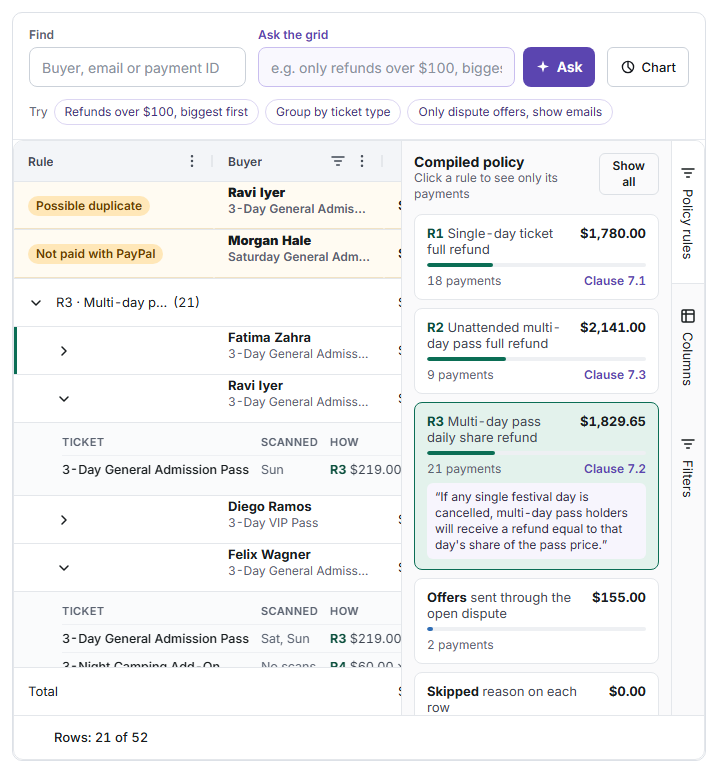
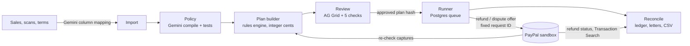

<div align="center">


# RefundsOut

**A day was cancelled. Refund everyone exactly right, once.**

RefundsOut turns a festival's ticket terms into tested refund rules, shows every buyer's refund in a grid
before any money moves, and sends each refund through PayPal exactly once.


-003087?logo=paypal&logoColor=white)


<br />


</div>

---

## The problem

When one day of a multi-day festival is cancelled, the organiser owes thousands of buyers **different** amounts.
A Sunday-only ticket gets everything back. A weekend pass holder who came on Friday gets part of it back.
A VIP package has a non-refundable hospitality fee. Some buyers paid cash, some got free tickets, some were already refunded.

Today this is done by hand in a spreadsheet, and the expensive mistakes are always the same:
the wrong amount, a buyer refunded twice, or a refund sent for a payment that changed since someone last looked.

## What RefundsOut does

| Step | What happens |
|---|---|
| **1. Import** | Upload ticket sales, gate scans and ticket terms in any layout. Gemini maps the columns. Bad rows (no email, price `N/A`, duplicate ticket IDs) are set aside with a reason, never silently dropped. |
| **2. Policy** | Gemini compiles the terms into numbered rules (`R1`, `R2`…) and deductions (`D1`…), each quoting its clause. The rules run against test cases. A person approves a policy version only when every test passes. |
| **3. Review** | Every refund appears in an **AG Grid** before anything is sent. It is grouped by rule with totals, and exceptions that need a decision are pinned to the top. There is also a chart of refund dollars by rule, a side panel of the compiled policy, expandable per-ticket math, "Ask the grid" in plain English, and a "Why this amount" panel for each buyer. |
| **4. Run** | Five checks must pass before **Run refunds** unlocks. Refunds then go out through PayPal, a few at a time, each with a fixed request ID. |
| **5. Reconcile** | Every cent of the plan is accounted for, every refund is confirmed with PayPal, duplicates are counted (should be 0), and each buyer gets a letter with their exact amount. |

## Built to never pay twice

RefundsOut is careful in the places where refund tools usually go wrong:

- **Five checks lock the Run button.** Policy approved and tested, every payment re-checked with PayPal within the last hour, no open exceptions, total within budget, and sign-off. Runs over the approval limit ($2,500 by default) need **two different people**.
- **Any edit cancels the approval.** Approvals are tied to a hash of the exact plan.
- **Each payment is re-checked right before money moves.** A payment that was charged back, disputed or refunded elsewhere since approval is skipped, not paid.
- **Fixed `PayPal-Request-Id` per refund.** Retries, crashes and restarts resend the same ID, so PayPal returns the original refund instead of creating a second one.
- **A ledger of its own refunds.** PayPal's view can lag. RefundsOut also counts what it already sent in earlier plans for the same event.
- **Crash-safe queue.** Refunds are claimed from Postgres with `FOR UPDATE SKIP LOCKED`. Half-finished work is put back in the queue when the server starts.
- **Open disputes get an offer, not a refund.** A payment under dispute is paid through the PayPal dispute with a seller offer.
- **Everything is in the audit log:** who imported, who approved, every skip and every refund.

## How AI is used (and where it is not)

| Gemini does | Code does |
|---|---|
| Maps unfamiliar CSV columns and ticket codes | Validates every row and sets aside bad ones |
| Compiles ticket terms into rules with clause quotes | Runs the rules against tests; a person approves the version |
| Answers "Ask the grid" (e.g. *only refunds over $100, biggest first*) with the AG Grid AI Toolkit | Cleans the answer, applies it as grid state (view only, never amounts) and shows what changed as chips |
| Writes the wording of each buyer letter | Fills in every amount, date and PayPal ID, and rejects any wording that leaves out the amount |

**No money amount is ever written by AI.** Amounts come from the rules engine, which uses integer cents.

## PayPal APIs used

| API | Used for |
|---|---|
| `GET /v2/payments/captures/{id}` | Re-checking each payment's refundable amount and status |
| `POST /v2/payments/captures/{id}/refund` | Sending each refund, with `PayPal-Request-Id` |
| `GET /v2/payments/refunds/{id}` | Confirming refunds during the run and in Reconcile |
| `GET /v1/customer/disputes/{id}` and `POST …/make-offer` | Paying disputed payments through the dispute |
| `GET /v1/reporting/transactions` | Transaction Search cross-check for the finance file |
| `GET /v2/checkout/orders/{id}` | Reading every refund already made on a payment, including pending ones from disputes |

All calls run against the **PayPal sandbox**.

## How RefundsOut uses AG Grid

In RefundsOut the grid is **the approval gate**, not a report at the end. No refund is sent until someone has reviewed the whole
plan in AG Grid and all five checks pass. The same grid then shows the run live and holds the audit trail.

<table>
<tr>
<td width="50%"></td>
<td width="50%"></td>
</tr>
<tr>
<td><b>Ask the grid.</b> A plain-English question becomes real grid state, and the chips show exactly what the AI changed.</td>
<td><b>Policy rules panel.</b> A custom tool panel lists each compiled rule with its clause, payment count and dollars. Clicking a rule filters the grid. Expanding a payment shows the per-ticket math.</td>
</tr>
</table>

| Screen | AG Grid Enterprise feature | What it does for the person approving refunds |
|---|---|---|
| Review | **AI Toolkit**: `getStructuredSchema()` → Gemini → `setState()` | "Ask the grid" in plain English (*refunds over $100, biggest first*). The answer is applied as normal grid state and listed as chips (**Filter** Refund > $100 · **Sort** Refund ↓). |
| Review | Row grouping, `sum` aggregation, grand total row | Refund dollars per rule (R1, R2…) and the plan total, always in sync with the rows |
| Review | **Integrated Charts**: cross-filter donut with a custom chart theme | Refund dollars by rule. Clicking a slice filters the grid. |
| Review | **Custom tool panel** (React) in the side bar, next to the built-in Columns and Filters panels | The compiled policy, rule by rule, with clause quotes. Clicking a rule filters to its payments. |
| Review | **Master-detail** with a custom detail renderer | Expand a payment to see each ticket, the days scanned, the rule, the formula and the amount |
| Review | Pinned top rows + custom cell renderers | Payments that need a human decision (possible duplicate, not paid with PayPal) stay on top with inline Refund / Skip buttons |
| Review | Cell editing with `valueParser` | Changing a refund opens a dialog that requires a reason. The edit is audited and cancels any approval. |
| Review | Cell selection + **status bar** aggregation | Drag over refund cells to see their sum, average and count |
| Review | **Excel export** with `excelStyles`, `prependContent`, group outlines | An audit-ready workbook: a summary block (total vs budget, each check ✓/✗, approvals), currency formats, and extra audit columns (payment ID, policy amount, reason, edit note) |
| Run | Live row updates with `getRowId` + cell change flash | Each payment's status changes in place as refunds go out |
| Audit log | Row group panel, set filters, quick filter, master-detail | Drag Stage, Who or What to group. Expand any entry to see its full JSON. |
| All | `themeQuartz.withParams` | One theme in the product's colours across every grid |

**"Ask the grid", made safe for real money:**

- The AI only ever changes the **view** (filters, sort, grouping, visible columns). It cannot change an amount.
- Before applying an answer, the app cleans it: it drops no-op filters such as "is not blank" and keeps audit columns hidden unless the question asks for them. The answer is layered on the grid's starting view, so **Reset** always returns to the rule grouping.
- If Gemini is busy, the three example questions apply a stored answer and say so. A typed question shows a plain message. The grid never hangs.

**Code:**
- [`src/ui/grid.ts`](src/ui/grid.ts): modules, theme, chart theme, status bar, Excel styles, and the state-to-chips description
- [`ReviewClient.tsx`](app/events/%5Bid%5D/review/ReviewClient.tsx): the Review grid and Ask the grid
- [`RulesToolPanel.tsx`](app/events/%5Bid%5D/review/RulesToolPanel.tsx): the custom tool panel
- [`RunClient.tsx`](app/events/%5Bid%5D/run/RunClient.tsx): the live run grid
- [`AuditGrid.tsx`](app/events/%5Bid%5D/audit/AuditGrid.tsx): the audit log grid

## Architecture



**Stack:** Next.js 16 (App Router, Server Actions) · React 19 · TypeScript · Tailwind CSS 4 · PostgreSQL (`pg`) · Zod · Google Gen AI SDK · AG Grid Enterprise 36 + AG Charts Enterprise 14 · Vitest.

## Run it locally

**Needs:** Node.js 22+, PostgreSQL, a PayPal developer account (sandbox app), a Gemini API key and an AG Grid Enterprise license key.
Without an AG Grid key everything still works; the grid just shows AG Grid's trial watermark.

```bash
git clone https://github.com/singhrahul7988/RefundsOut.git
cd RefundsOut
npm install

cp .env.example .env        # fill in PayPal sandbox, Gemini, AG Grid and DATABASE_URL
npm run db:migrate          # creates the tables (safe to run again)
npm run check:sandbox       # confirms the PayPal sandbox app works
npm run dev                 # http://localhost:3000
```

On the home page, click **Try with sample festival data** for a one-click demo. Every click creates its own
50 fresh sandbox payments (about 15 seconds), so each person can take the run all the way to real refunds
without using up anyone else's.

### Test files with real sandbox payments

[`test-files/`](test-files/) holds a second festival, **Lakeshore Lights Festival 2026** (Sunday cancelled), with its own column names,
US dates, a parking add-on and deliberate edge cases. Every PayPal ID in it is a real sandbox payment, so the run really refunds them.
Expected results are in [`test-files/README.md`](test-files/README.md).

A sandbox payment can only be refunded once. After a full run, create a fresh set:

```bash
npx tsx --env-file=.env scripts/seed-test-files.ts --force
```

### Commands

| Command | What it does |
|---|---|
| `npm run dev` | Start the app on port 3000 |
| `npm run build` / `npm start` | Production build and server |
| `npm run db:migrate` | Apply `db/schema.sql` |
| `npm run check:sandbox` | Check the PayPal sandbox credentials end to end |
| `npm test` | Unit tests (money, rules engine, date parsing) |
| `npm run typecheck` | TypeScript check |

## Project layout

```
app/                 Pages: home, import, policy, review, run, reconcile, audit log
src/ai/              Gemini: column mapping, policy compile, letters, "Ask the grid"
src/import/          CSV parsing and row checks
src/policy/          Policy schema, rules engine, tests
src/plan/            Plan builder and the five Review checks
src/run/             Refund runner (Postgres queue, retries, crash resume)
src/paypal/          PayPal REST client
db/schema.sql        Database schema
scripts/             Migrations, sandbox checks, test data seeding
test-files/          Lakeshore demo files
```

## Built for

The **PayPal AI Hackathon 2026**. Sandbox only: no real money moves.

## License

[MIT](LICENSE) © 2026 Rahul Singh
